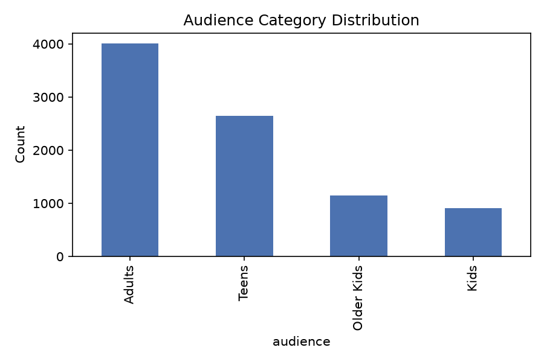
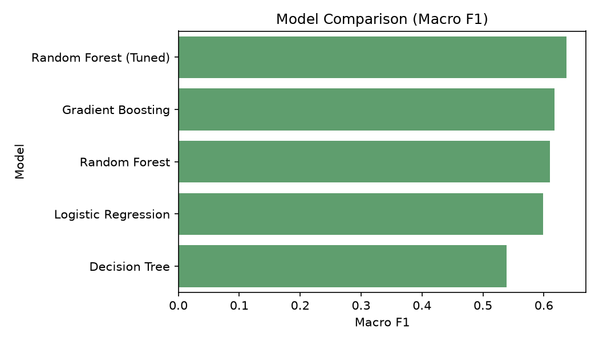
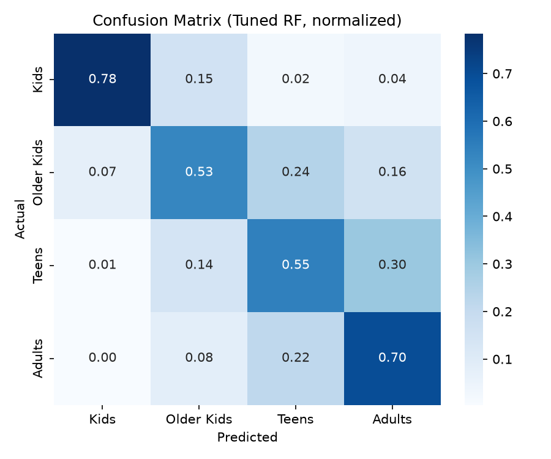
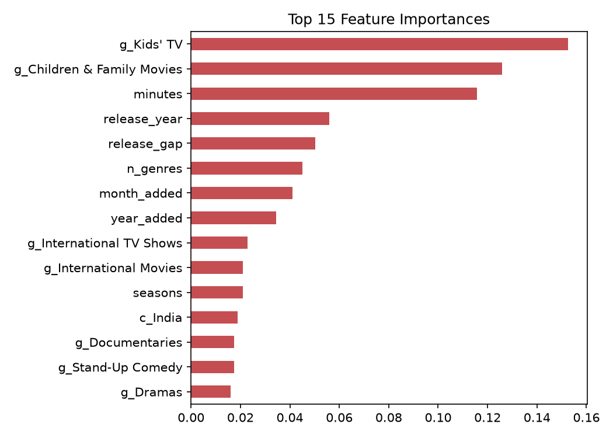

# Auspify ML Internship – Task 3: Netflix Audience Rating Classification

[](https://www.python.org/downloads/)
[](https://scikit-learn.org/)
[]()

> **Project Goal**: Predict the target audience maturity category (`Kids`, `Older Kids`, `Teens`, `Adults`) for Netflix content based on metadata, structured runtime attributes, and genre signals using production-ready machine learning engineering practices.

---

## Table of Contents
1. [Project Overview & Problem Statement](#project-overview--problem-statement)
2. [Dataset Overview](#dataset-overview)
3. [Project Architecture](#project-architecture)
4. [Installation & Setup](#installation--setup)
5. [How to Run](#how-to-run)
6. [Methodology & Engineering Principles](#methodology--engineering-principles)
   - [Audience Mapping (14 &rarr; 4 Categories)](#audience-mapping-14--4-categories)
   - [Feature Engineering Pipeline](#feature-engineering-pipeline)
   - [Train-Only Preprocessing & Scaling](#train-only-preprocessing--scaling)
7. [Experimental Results & Evaluation](#experimental-results--evaluation)
8. [Visualizations](#visualizations)
9. [Error Analysis & Limitations](#error-analysis--limitations)
10. [Future Directions](#future-directions)

---

## Project Overview & Problem Statement

Netflix catalogs thousands of titles globally, each governed by different regional rating bodies (e.g., MPAA, TV Parental Guidelines). Raw maturity ratings feature high cardinality (14 distinct tags) and severe class imbalance, with sparse categories such as `NC-17` (3 titles) and `TV-Y7-FV` (6 titles) lacking statistical representation.

This project refactors a monolithic analysis script into a production-grade, modular Python machine learning package that:
- Standardizes ratings into 4 clear age-appropriate audience tiers: **Kids**, **Older Kids**, **Teens**, and **Adults**.
- Learns structural, temporal, and categorical features from training rows.
- Benchmarks multiple baseline classifiers (`Logistic Regression`, `Decision Tree`, `Random Forest`, `Gradient Boosting`).
- Tunes an ensemble `RandomForestClassifier` with Stratified Grid Search to optimize balanced **Macro F1**.
- Includes unit and integration tests and an end-to-end Jupyter Notebook.

---

## Dataset Overview

The dataset (`data/raw/Dataset.csv`) contains **8,790 titles** with **10 attributes**:

| Column Name | Type | Description |
|---|---|---|
| `show_id` | String | Unique identifier for each title |
| `type` | String | Format of content (`Movie` or `TV Show`) |
| `title` | String | Title of the film or series |
| `director` | String | Director name(s) or `"Not Given"` |
| `country` | String | Country or comma-separated countries of production |
| `date_added` | String | Date the title was added to Netflix catalog |
| `release_year` | Integer | Original year of release |
| `rating` | String | Raw MPAA / TV guideline maturity tag |
| `duration` | String | Runtime (e.g., `"90 min"` for movies, `"2 Seasons"` for shows) |
| `listed_in` | String | Comma-separated list of genres |

---

## Project Architecture

```
Task3_Rating/
├── data/
│   └── raw/
│       └── Dataset.csv               # Authorized local dataset
├── src/
│   └── rating_classifier/
│       ├── __init__.py               # Package metadata and version
│       ├── config.py                 # Dataclasses, paths, mappings, hyperparameter grids
│       ├── data.py                   # Data loading, validation, audience mapping
│       ├── features.py               # Pure feature engineering functions
│       ├── models.py                 # Estimator factory, baseline trainer, RF tuner
│       ├── evaluate.py               # Metrics computation, cross-validation helpers
│       ├── visualize.py              # Exportable matplotlib/seaborn plot generators
│       └── pipeline.py               # End-to-end pipeline orchestrator (run())
├── tests/
│   ├── test_data.py                  # Unit tests for loading, mapping, NR/UR filtering
│   ├── test_features.py              # Unit tests for duration parsing, date extraction, encodings
│   └── test_pipeline.py              # Integration tests verifying end-to-end pipeline
├── notebooks/
│   └── task3_rating_classification.ipynb  # Executed interactive analysis notebook
├── outputs/                          # Generated plots and evaluation tables
│   ├── 01_class_distribution.png
│   ├── 02_model_comparison.png
│   ├── 03_confusion_matrix.png
│   ├── 04_feature_importance.png
│   └── model_comparison.csv
├── main.py                           # CLI entry point with argparse & logging
├── pyrefly.toml                      # Language server & type checking configuration
├── conftest.py                       # Pytest path discovery configuration
├── requirements.txt                  # Pinned dependencies
├── .gitignore                        # Git exclusion rules
└── README.md                         # Project documentation
```

---

## Installation & Setup

Python 3.14.0 was used to verify this project. The pinned dependencies require
Python 3.12 or newer. The publication copy excludes the source CSV. Create
`data/raw/` and place an authorized copy at `data/raw/Dataset.csv` to run
training, execute the notebook, or run the full test suite. Redistribution
permission for the supplied CSV remains unverified.

### 1. Clone & Set Up Virtual Environment

```bash
# Run from the repository root
# Create and activate virtual environment (Windows PowerShell)
python -m venv .venv
.\.venv\Scripts\Activate.ps1

# On Linux/macOS:
# python3 -m venv .venv
# source .venv/bin/activate
```

### 2. Install Dependencies

```bash
python -m pip install -r requirements.txt
```

---

## How to Run

### Command-Line Pipeline Execution

Run the complete pipeline end-to-end:

```bash
# Run with default parameters
python main.py

# Specify custom dataset path and output directory
python main.py --data data/raw/Dataset.csv --out outputs

# Enable detailed debug logging
python main.py --log DEBUG
```

### Run Test Suite

Run the unit and pipeline integration tests. Dataset-backed tests are skipped when the local CSV is absent.

```bash
python -m pytest -q
```

### Launch Jupyter Notebook

```bash
jupyter notebook notebooks/task3_rating_classification.ipynb
```

Or re-execute the notebook from terminal:

```bash
jupyter nbconvert --to notebook --execute --inplace notebooks/task3_rating_classification.ipynb
```

---

## Methodology & Engineering Principles

### Audience Mapping (14 &rarr; 4 Categories)
The 14 raw maturity ratings exhibit extreme imbalance: `TV-MA` (3,205) and `TV-14` (2,157) represent over 61% of the catalog, while `NC-17` (3) and `TV-Y7-FV` (6) have negligible volume. We consolidate them into 4 standardized audience tiers:

| Raw Rating | Audience Tier | Rationale |
|---|---|---|
| `TV-Y`, `TV-Y7`, `TV-Y7-FV`, `TV-G`, `G` | **Kids** | Early childhood and young child general audiences |
| `TV-PG`, `PG` | **Older Kids** | Parental guidance suggested; mild themes, minimal violence |
| `TV-14`, `PG-13` | **Teens** | Suitable for teenagers 13–14+; moderate violence, language |
| `TV-MA`, `R`, `NC-17` | **Adults** | Mature audiences only; explicit language, violence, sexual content |

*Note on Unrated Titles*: Titles labeled `NR` (79) or `UR` (3) carry no explicit age rating guidance and are excluded from supervised training to prevent injecting noisy labels (82 rows dropped, 8,708 rows retained).

This is a modeling assumption rather than an official crosswalk between
regional rating systems. `TV-G` and `G` are grouped with **Kids**, while
`TV-PG` and `PG` form **Older Kids**. The source and redistribution license
of this CSV were not provided with the project and must be verified before
public redistribution.

### Feature Engineering Pipeline
Feature extraction functions operate on copies of their inputs. In the
training pipeline, `FeatureTransformer` is fitted only on the training
partition (and independently inside each cross-validation fold):
1. **Duration Decomposition**: Extracts numeric values, assigning them to `minutes` (for Movies) and `seasons` (for TV Shows) based on the `is_movie` indicator.
2. **Temporal Features**: Extracts `year_added`, `month_added`, and calculates `release_gap = year_added - release_year` to model catalog acquisition delay.
3. **Metadata Complexity Flags**: Creates `has_director`, `n_countries` (count of co-producing nations), and `n_genres`.
4. **Primary Country One-Hot Encoding**: Isolates the primary producing country; the top 10 countries are one-hot encoded (`c_*`) while the long-tail is grouped into `"Other"`.
5. **Genre Multi-Hot Encoding**: Parses multi-label genre tags (`listed_in`) and encodes genres with $\ge 50$ occurrences (`g_*`).

### Train-Only Preprocessing & Scaling
- The dataset is split into an **80/20 stratified split** (`random_state=42`) before learning the date median, country vocabulary, or genre vocabulary.
- The feature transformer and `StandardScaler` are fitted strictly on training data; test data is transformed only.
- Random Forest tuning uses a sklearn `Pipeline`, so every GridSearchCV/CV fold refits preprocessing on that fold's training data.
- Tree-based estimators (`RandomForestClassifier`, `DecisionTreeClassifier`, `GradientBoostingClassifier`) operate on native unscaled feature scales.

---

## Experimental Results & Evaluation

### Benchmark Comparison

Evaluated on the unseen stratified test set (1,742 samples):

| Model | Test Accuracy | Balanced Accuracy | Macro Precision | Macro Recall | Macro F1 | Weighted F1 | Notes |
|---|---:|---:|---:|---:|---:|---:|---:|
| **Random Forest (Tuned)** | **0.6383** | **0.6388** | **0.6408** | **0.6388** | **0.6376** | **0.6429** | **Best Macro F1; GridSearchCV** |
| Random Forest (Baseline) | 0.6257 | 0.6089 | 0.6116 | 0.6089 | 0.6103 | 0.6254 | 300 trees, balanced class weights |
| Gradient Boosting | 0.6441 | 0.5885 | 0.6883 | 0.5885 | 0.6174 | 0.6257 | Highest accuracy, lower balanced recall |
| Logistic Regression | 0.6051 | 0.6119 | 0.5948 | 0.6119 | 0.5988 | 0.6138 | Standardized features, balanced weights |
| Decision Tree | 0.5040 | 0.5535 | 0.6059 | 0.5535 | 0.5389 | 0.5156 | Max depth = 8 |

### Tuned Random Forest Classification Report

```text
              precision    recall  f1-score   support
        Kids       0.86      0.78      0.82       181
  Older Kids       0.42      0.53      0.46       230
       Teens       0.55      0.55      0.55       529
      Adults       0.73      0.70      0.72       802

    accuracy                           0.64      1742
   macro avg       0.64      0.64      0.64      1742
weighted avg       0.65      0.64      0.64      1742
```

- **5-fold sensitivity check on the full dataset** reports Macro F1 **0.5870 ± 0.0343** using the selected hyperparameters. It reuses rows involved in tuning. The holdout scores come from rows excluded from tuning and are subject to the title overlap described below.
- **Train Macro F1**: **0.7400**; **Test Macro F1**: **0.6376**
- **Optimal Hyperparameters**: `max_depth=15`, `max_features='sqrt'`, `min_samples_leaf=3`, `n_estimators=400`

---

## Visualizations

Notebook screenshots from a fresh run show the [raw rating distribution](screenshots/01-rating-distribution.png),
[model comparison](screenshots/02-model-evaluation.png), and
[normalized confusion matrix](screenshots/03-confusion-matrix.png).

### 1. Target Audience Category Distribution
Distribution of the consolidated audience tiers across the 8,708 titles:


### 2. Model Performance Benchmark (Macro F1)
Comparison across all baseline models and the tuned Random Forest:


### 3. Normalized Confusion Matrix
Prediction breakdown on the test set for the tuned Random Forest:


### 4. Top-15 Feature Importances
Most informative features derived from Gini impurity reduction:


---

## Error Analysis & Limitations

### 1. Older Kids vs. Teens Boundary Confusion
The confusion matrix shows that **24% of Older Kids** are predicted as **Teens**, and **14% of Teens** are predicted as **Older Kids**.
- **Likely Reason**: The regulatory criteria distinguishing `PG` from `PG-13`/`TV-14` rely on subtle thematic nuances, profanity thresholds, and intensity of dramatic tension rather than metadata fields.
- **Shared Categorical Profile**: Both categories frequently share broad tags such as `Comedies`, `Action & Adventure`, and `Dramas`.

### 2. Metadata Limitations
Without narrative content, metadata alone (runtime, release year, producing country, broad genre) cannot disambiguate two titles with identical structural profiles (e.g., a 90-minute American comedy could be family-oriented `PG` or raunchy `R`/`TV-MA`).

### 3. Data Quality Notes
- **Duplicate Titles**: There are three extra rows with exactly repeated titles. Five punctuation- and case-normalized title keys cross the split, including one pair with the same audience label and all 58 model features identical. A title-grouped evaluation is needed to estimate the effect of repeated content on the holdout scores.
- **No Synopsis or Description Column**: The dataset lacks any free-text field (synopsis, plot summary, content description). Rating boards evaluate maturity based on actual content substance (violence level, language, sexual themes, substance use) — information that is entirely absent from the available metadata columns.

---

## Future Directions

1. **Natural Language Processing (NLP)**:
   - Extract TF-IDF n-grams or dense transformer embeddings (e.g., `all-MiniLM-L6-v2`) from plot descriptions and synopses.
   - Text sentiment and profanity scoring provide direct proxies for maturity ratings.
2. **External Data Enrichment**:
   - Ingest IMDb / TMDb parental advisories (detailed breakdown of violence, profanity, alcohol/drugs, and frightening scenes).
3. **Hierarchical Multi-Stage Classification**:
   - Stage 1: Classify Minor (`Kids`/`Older Kids`/`Teens`) vs. `Adults`.
   - Stage 2: Sub-classify Minor titles into `Kids` vs. `Older Kids` vs. `Teens`.

---

**Developed for the Auspify ML Internship – Task 3.**
